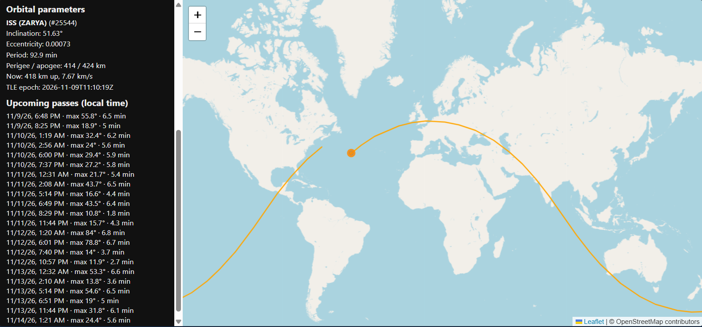
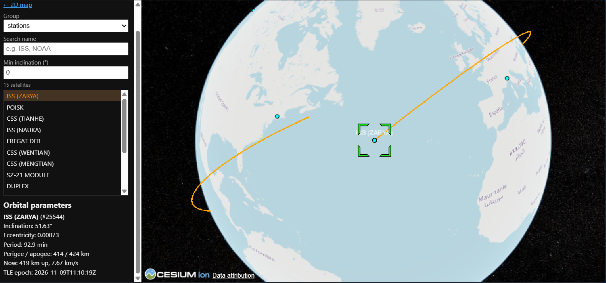
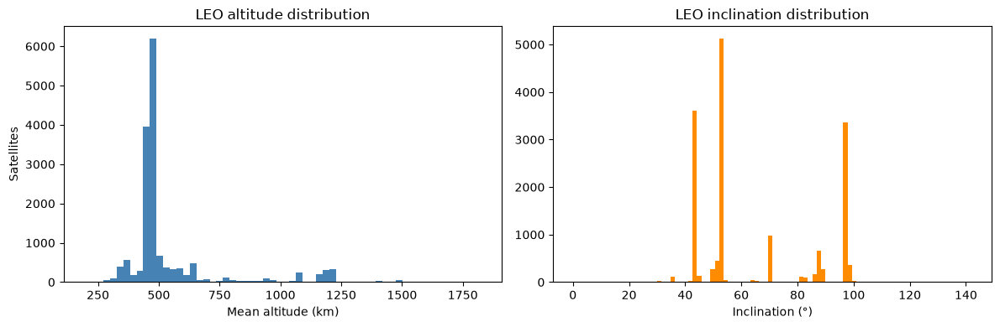

# Satellite Tracker


Real-time satellite tracking with 2D and 3D maps, ground tracks, orbital parameters, and flyover predictions, plus an analysis of the full active satellite catalog.





## Features

- **Live positions** for satellites from CelesTrak groups (stations, visual, weather, GPS, science), refreshed every 5 seconds
- **2D map (Leaflet)** and **3D globe (CesiumJS)** views backed by the same API
- **Ground tracks** for the next ~95 minutes (about one ISS orbit), split correctly at the ±180° date line
- **Orbital parameters:** inclination, eccentricity, period, perigee/apogee, altitude, speed, and TLE epoch
- **Flyover predictions** for any latitude/longitude, with rise time, max elevation, and duration
- **Filters:** satellite group, name search, minimum inclination, and maximum orbital period
- **Cached data:** TLEs are stored on disk and refreshed at most every 2 hours, per CelesTrak's guidelines
- **Tested:** pytest suite with GitHub Actions CI

## Tech stack

Python, FastAPI, Skyfield (SGP4 propagation), CelesTrak data, Leaflet, CesiumJS, pandas and matplotlib (analysis), pytest.

## Quick start

Requires Python 3.10+.

```bash
git clone https://github.com/adiaksh22/satellite-tracker.git
cd satellite-tracker
python -m venv .venv
```

Activate the environment:

```bash
# Windows (PowerShell)
.venv\Scripts\Activate.ps1
# macOS / Linux
source .venv/bin/activate
```

Install and run:

```bash
pip install -r requirements.txt
uvicorn app.main:app --reload
```

Then open:

- `http://127.0.0.1:8000/` for the 2D map
- `http://127.0.0.1:8000/globe.html` for the 3D globe
- `http://127.0.0.1:8000/docs` for the interactive API docs

The first request downloads data from CelesTrak, so it may take a few seconds. Run the tests with `python -m pytest`.

## API

| Endpoint | Description |
|---|---|
| `GET /api/groups` | Available satellite groups |
| `GET /api/satellites` | Positions and orbital parameters. Filters: `group`, `q`, `min_incl`, `max_incl`, `max_period` |
| `GET /api/satellites/{norad}/track` | Ground track segments |
| `GET /api/satellites/{norad}/passes` | Upcoming passes. Params: `lat`, `lon`, `days`, `min_elev` |

## Analysis

The `analysis/` folder contains a notebook that analyzes CelesTrak's full `active` catalog (16,872 satellites, snapshot taken November 6, 2026) and validates the app's predictions against independent sources.



**Findings**

- **LEO dominates:** 95.2% of active satellites are in low Earth orbit; GEO is 3.5%, MEO 1.1%, HEO 0.3%.
- **One operator is most of LEO:** Starlink is 69.8% of LEO satellites (11,204 of 16,058).
- **Altitude is concentrated:** 10,118 LEO satellites (about 63%) sit in a single 450-500 km band, 93.9% of them Starlink. A second tier at 1,050-1,250 km is 94% OneWeb, Hulianwang, and Qianfan.
- **Inclinations cluster** near 43°, 53°, and 97°, mostly reflecting Starlink's orbital shells.
- **The data is fresh:** median element-set age is 0.56 days.

Regime cutoffs (for example, LEO under 2,000 km mean altitude) are my own definitions and are documented in the notebook.

**Validation**

- **Pass predictions vs. Heavens-Above:** all 44 passes over San Jose in a 10-day window had a matching prediction, with no extras. Rise and peak times differed by at most 1 second, and peak elevation by at most 0.5° (the source reports whole seconds and degrees).
- **Position vs. wheretheiss.at:** 5.8 km ground-position difference across 10 readings, under one second of orbital motion.
- Both sources use the same public orbital data, so this validates the implementation, not the accuracy of the element sets themselves.

To run the notebook:

```bash
pip install -r analysis/requirements.txt
```

Then open `analysis/satellite_analysis.ipynb` and select the project's `.venv` kernel.

## Limitations

- Positions come from TLEs (two-line element sets) propagated with SGP4. Accuracy degrades as the element set ages, and maneuvers such as ISS reboosts can shift the orbit.
- Passes are **geometric** (the satellite is above the horizon), not necessarily **visible**. In the validation window only 11 of 44 ISS passes (25%) were visible; the rest were in daylight or Earth's shadow.
- The map shows at most 200 satellites at a time to stay responsive.
- The ground track covers about one orbit ahead and does not show the past.
- The 3D globe uses OpenStreetMap imagery without terrain, so it needs no Cesium Ion token.

## Roadmap

- Visible-passes-only filter using sunlit/dark calculations
- Time slider to scrub positions forward and backward
- Cached pass results per satellite and location
- Hosted demo

## Credits

Orbital data from [CelesTrak](https://celestrak.org). Pass predictions validated against [Heavens-Above](https://www.heavens-above.com), and positions against the [Where the ISS at?](https://wheretheiss.at) API. Built with [Skyfield](https://rhodesmill.org/skyfield/), [FastAPI](https://fastapi.tiangolo.com), [Leaflet](https://leafletjs.com), and [CesiumJS](https://cesium.com/platform/cesiumjs/). Map tiles © OpenStreetMap contributors.

## License

MIT. See [LICENSE](LICENSE).